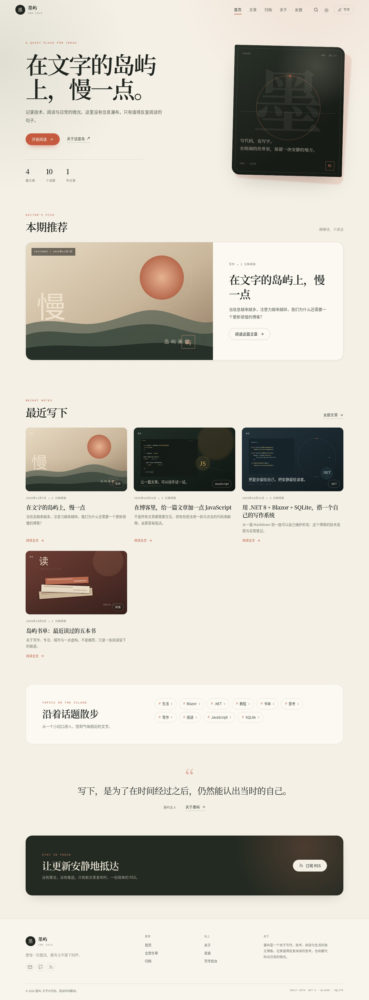
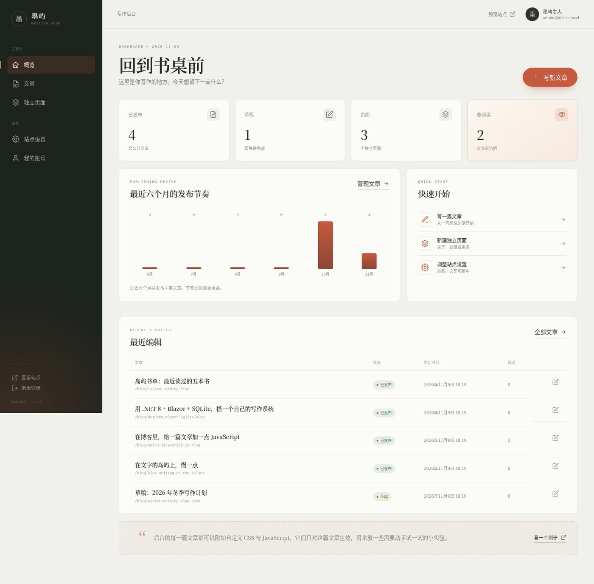
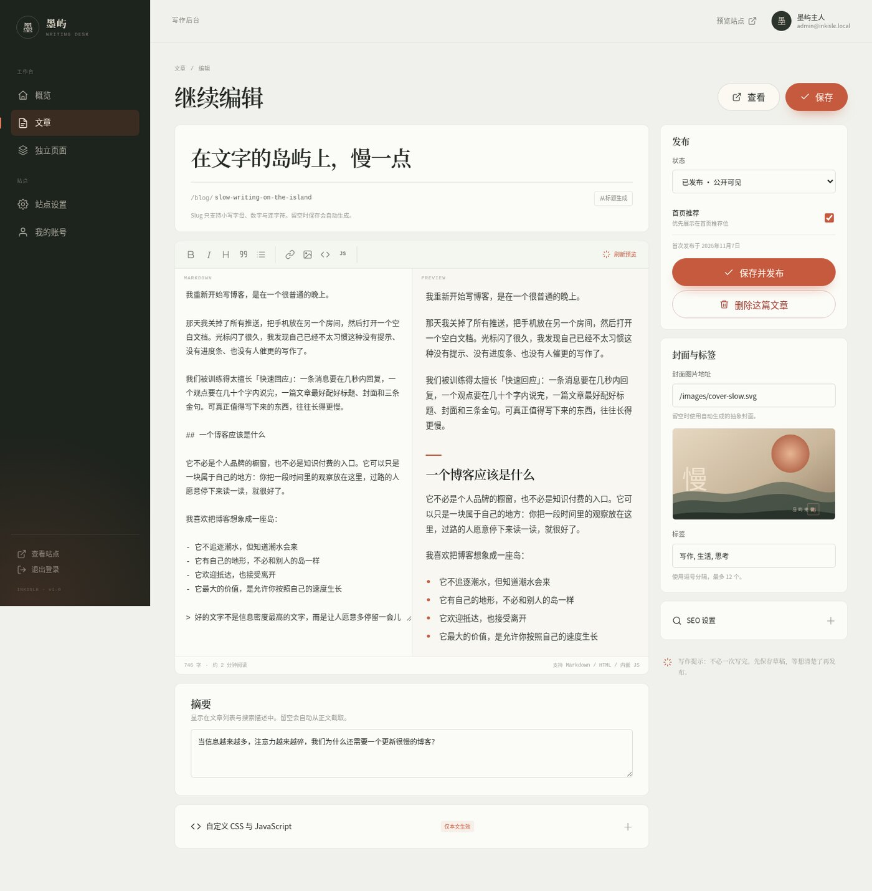
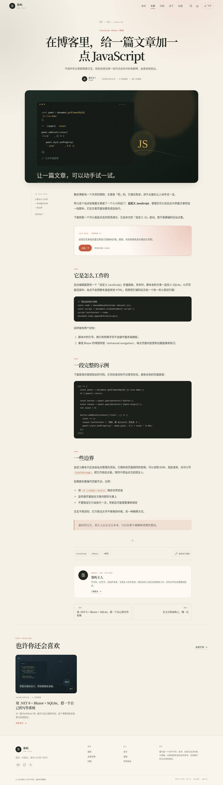

# 墨屿 InkIsle

一个用 **.NET 8 + Blazor Web App + EF Core + SQLite** 搭建的完整博客系统。前台是静态服务端渲染的阅读站，后台是交互式写作台；支持 Markdown 在线编辑、文章/独立页面管理、标签与归档、RSS/Sitemap，以及按文章或全站注入自定义 CSS / JavaScript。



## 功能一览

### 公开站点

- 首页：编辑推荐、最新文章、话题云、站点介绍
- 文章列表：搜索、标签筛选、分页
- 文章详情：Markdown 渲染、目录、阅读进度、相关文章、上一篇/下一篇、阅读量
- 归档页：按年份整理全部文章
- 动态独立页面：例如「关于」「友链」，支持显示在顶部导航
- 标签页、全文搜索、RSS、Sitemap、robots.txt
- 响应式布局、深浅色主题、文章内代码复制、阅读进度条
- 文章级 / 页面级自定义 CSS 与 JavaScript
- 站级自定义 CSS 与 JavaScript（全站公开页面生效）

### 写作后台

- 管理员登录、Cookie 认证、`Admin` 角色授权
- 仪表盘：文章数、草稿数、页面数、阅读量、近六个月发布节奏
- 文章管理：搜索、状态筛选、编辑、删除、发布/草稿、首页推荐
- 双栏 Markdown 编辑器：工具栏、实时预览、摘要、封面、标签、SEO
- 独立页面管理：导航显示、排序、发布状态、自定义样式和脚本
- 站点设置：站名、首页文案、作者信息、强调色、页脚、全站 CSS/JS
- 账号设置：显示名称、修改密码
- 文章 Slug 自动生成与唯一性校验；内置防重复、防误删确认







## 技术栈

| 模块       | 技术                                          |
| -------- | ------------------------------------------- |
| 运行时      | .NET 8                                      |
| Web      | Blazor Web App（静态 SSR + Interactive Server） |
| 数据       | EF Core 8 + SQLite                          |
| 认证       | ASP.NET Core Identity（Cookie + Role）        |
| Markdown | Markdig 0.38                                |
| 前端       | 原生 CSS + Vanilla JavaScript，无前端构建链          |

## 快速开始

### 1. 准备 .NET 8 SDK

```bash
dotnet --list-sdks
```

需要 8.0.x SDK。项目中的 `global.json` 会把 SDK 固定到 8.0 系列。

### 2. 运行

```bash
cd InkIsle
dotnet restore
dotnet run
```

打开 <http://localhost:5088>。

也可以使用内置脚本（如果当前工作区存在 `.dotnet` 本地运行时，会优先使用它）：

```bash
cd InkIsle
./run.sh
```

### 3. 进入后台

- 地址：<http://localhost:5088/admin>
- 邮箱：`admin@inkisle.local`
- 密码：`InkIsle@2026`

> 这是本地演示账号。首次登录后请立刻在「我的账号」中修改密码。生产环境不要保留默认密码。

首次启动会自动执行 EF Core 迁移、创建 SQLite 数据库、写入管理员和示例文章/页面。

## 数据库

默认数据库文件：

```text
InkIsle/App_Data/inkisle.db
```

连接字符串在 `appsettings.json`：

```json
"ConnectionStrings": {
  "DefaultConnection": "Data Source=App_Data/inkisle.db;Cache=Shared"
}
```

应用启动时调用 `Database.MigrateAsync()`，无需手动建库。

备份：

```bash
cp App_Data/inkisle.db backups/inkisle-$(date +%F).db
```

重置演示数据（会删除全部内容）：

```bash
# 先停止应用
rm App_Data/inkisle.db
dotnet run
```

## 管理员与配置

默认管理员来自 `appsettings.json` 的 `Seed` 节点：

```json
"Seed": {
  "AdminEmail": "admin@inkisle.local",
  "AdminPassword": "InkIsle@2026",
  "AdminDisplayName": "墨屿主人"
}
```

生产环境建议通过环境变量覆盖密码：

```bash
export Seed__AdminPassword='一个更强的密码'
dotnet run
```

种子逻辑只在管理员不存在时创建用户，不会覆盖已有账号密码；已有管理员请通过后台修改密码。

### 登录安全

- 不开放注册，后台只允许 `Admin` 角色访问
- 登录失败会触发 Identity 锁定策略（6 次 / 10 分钟）
- Cookie 默认保持 14 天
- 数据保护密钥持久化在 `App_Data/keys/`，重启后登录态不会失效
- 自定义 JS 拥有页面权限，仅应添加可信代码

## 在线编辑器

编辑器地址：

```text
/admin/posts/new
/admin/posts/{id}/edit
```

主要能力：

- 标题、Slug、摘要、正文、封面地址、标签
- 草稿 / 发布状态、首页推荐
- 工具栏：加粗、斜体、标题、引用、列表、链接、图片、代码块、JS 代码块
- 编辑 / 预览双栏，预览使用与服务端相同的 Markdig 管线
- 自定义 CSS、JavaScript、SEO 标题与描述
- 保存后自动跳转到编辑地址，并提示成功
- 未保存修改在关闭页面时提示

Slug 规则：小写字母、数字、连字符，不能使用 `admin`、`blog` 等保留路径；留空时从标题自动生成。

## 内嵌 JavaScript 支持

后台提供三个层级的自定义代码入口：

1. **文章级**：文章编辑页 →「自定义 CSS 与 JavaScript」
2. **页面级**：独立页面编辑页 →「自定义 CSS 与 JavaScript」
3. **全站级**：站点设置 →「全站 CSS 与 JavaScript」

文章/页面级脚本只在该内容页面生效；全站脚本只注入公开页面，不会进入后台。

实现方式：

- 内容以 Base64 放在 `data-*` 属性中，避免引号/换行破坏 Razor 模板
- `wwwroot/js/site.js` 中的运行器解码后注入 `<style>` / `<script>`
- 支持 Blazor Enhanced Navigation：每次增强导航后重新执行
- 文章正文里的 Markdown 支持内嵌 HTML，示例文章「在博客里，给一篇文章加一点 JavaScript」包含一个可直接点击的现场演示

示例（文章正文）：

```html
<div id="js-live-demo">
  <button type="button">点我</button>
  <output data-output>等待点击</output>
</div>
```

对应自定义 JS：

```js
(() => {
  const panel = document.getElementById('js-live-demo');
  if (!panel) return;

  const button = panel.querySelector('button');
  const output = panel.querySelector('[data-output]');

  button.addEventListener('click', () => {
    output.textContent = '你好，岛屿 ✦';
  });
})();
```

> 安全提示：自定义 JS 可以读取和修改页面 DOM、访问 `localStorage`、发起请求。它等价于管理员权限的代码执行，不要开放给普通访客，也不要粘贴来源不明的代码。

## 目录结构

```text
InkIsle/
├─ Components/
│  ├─ Admin/                 # 后台布局、仪表盘、文章/页面/设置/账号
│  ├─ Account/               # 登录、退出、访问拒绝
│  ├─ Layout/                # PublicLayout / AdminLayout / AuthLayout
│  ├─ Pages/                 # 首页、文章、归档、标签、动态页面、404
│  ├─ Shared/                # Icon、PostCard、分页、SEO、自定义资源运行组件
│  ├─ App.razor
│  └─ Routes.razor
├─ Data/
│  ├─ BlogPost.cs
│  ├─ BlogPage.cs
│  ├─ SiteSettings.cs
│  ├─ ApplicationDbContext.cs
│  ├─ SeedData.cs
│  └─ Migrations/            # EF Core 初始迁移
├─ Services/
│  ├─ BlogService.cs
│  ├─ MarkdownService.cs
│  ├─ SiteSettingsService.cs
│  └─ ApplicationUserClaimsPrincipalFactory.cs
├─ wwwroot/
│  ├─ css/site.css
│  ├─ js/site.js
│  ├─ js/editor.js
│  └─ images/
├─ App_Data/                 # SQLite 数据库、数据保护密钥（运行时生成）
└─ Program.cs
```

## 路由

| 路由                       | 说明             |
| ------------------------ | -------------- |
| `/`                      | 首页             |
| `/blog`                  | 文章列表、搜索、标签筛选   |
| `/blog/{slug}`           | 文章详情           |
| `/tag/{name}`            | 标签页            |
| `/archive`               | 归档             |
| `/{slug}`                | 动态独立页面（关于、友链等） |
| `/admin`                 | 后台仪表盘          |
| `/admin/posts`           | 文章管理           |
| `/admin/posts/new`       | 新建文章           |
| `/admin/posts/{id}/edit` | 编辑文章           |
| `/admin/pages`           | 页面管理           |
| `/admin/settings`        | 站点设置           |
| `/admin/account`         | 账号设置           |
| `/account/login`         | 管理员登录          |
| `/feed.xml`              | RSS            |
| `/sitemap.xml`           | 站点地图           |
| `/robots.txt`            | 爬虫规则           |

## 构建与部署

```bash
dotnet publish -c Release -o ./publish
```

发布目录包含可直接运行的应用。生产部署建议：

- 使用 HTTPS，前面挂 Nginx/Caddy 反向代理
- 通过环境变量提供连接字符串与种子密码
- 定期备份 `App_Data/inkisle.db` 和 `App_Data/keys/`
- 不要在生产环境启用 `DetailedErrors`
- 如果使用容器，将 `App_Data` 挂载为持久卷

示例环境变量：

```bash
export ASPNETCORE_ENVIRONMENT=Production
export ConnectionStrings__DefaultConnection='Data Source=/data/inkisle.db;Cache=Shared'
export Seed__AdminEmail='you@example.com'
export Seed__AdminPassword='a-strong-password'
./publish/InkIsle
```

## 已验证

本项目在本地使用 .NET 8.0.427 完成构建与浏览器验证：

- 首页、文章列表、文章详情、动态页面、404
- 管理员登录 / 退出
- 文章创建、发布、跳转公开页
- 设置保存、账号保存
- 自定义文章 JS 交互
- 移动端首页、文章页、后台侧栏
- RSS / Sitemap / robots.txt / favicon
- 浏览器控制台 0 错误

## 说明

这是一个可运行、可扩展的完整博客基础版本，重点放在「写作」和「阅读」本身。后续可以继续加图片上传、评论、草稿自动保存、多作者或全文搜索索引。


*由哦鲸鲸强力驱动🐳*
